<div align="center">

<br>

<!-- NAME / TAGLINE - animated typing -->
<a href="https://github.com/harir03">
  
</a>

<br>

<!-- SOCIALS -->
<a href="https://github.com/harir03"></a>
<a href="https://linkedin.com/in/harireddy03"></a>
<a href="mailto:harireddy030207@gmail.com"></a>


</div>

---

## `~/` whoami

```console
$ cat about.txt
```

Hi, I'm **Hari Reddy**. I'm a pre-final year Electronics & Telecommunication student at AIT Pune who ended up building full-stack AI products. I like LLM tooling, agents, and anything that has to work outside a notebook. When I'm not coding, I'm at a hackathon or running E-Cell.

- 🚀 Currently building: **[AltGrade](https://altgrade.vercel.app)** (AI credit scoring), **[ARIA](https://github.com/harir03/aria)** (LLM-backed threat detection) and **[Verity](https://github.com/harir03/micro.ai)** (multi-agent PR verification)
- 🏆 Hackathons: 2nd at IIT Hyderabad, 2nd runner-up at IIT Delhi, 160th of 12,885 in HackerRank Orchestrate
- 🌱 Hacktoberfest 2025: 7 merged PRs
- 🎓 B.E. E&TC, AIT Pune (pre-final year)
- 🤝 Secretary, E-Cell: leading a 50-member team and events with 3000+ footfall
- 🎯 Looking for: SDE / AI internships
- 📫 Best way to reach me: [email](mailto:harireddy030207@gmail.com) or [LinkedIn](https://linkedin.com/in/harireddy03)

<br>

<div align="center">

## `~/` toolbox


<sub>Also: LangGraph / LangChain · MCP tooling · RAG · Ollama · XGBoost / LightGBM · ChromaDB</sub>

</div>

---

<div align="center">

## `~/` skill radar

<table>
<tr>
<td width="50%" align="center" valign="middle">

<!-- Unranked skill map - edit assets/skills.json, the workflow redraws it -->
<picture>
  <source media="(prefers-color-scheme: dark)"  srcset="assets/radar-dark.svg">
  <source media="(prefers-color-scheme: light)" srcset="assets/radar-light.svg">
  
</picture>

</td>
<td width="50%" align="center" valign="middle">

<!-- Live radar built from real language byte counts across your repos -->
<picture>
  <source media="(prefers-color-scheme: dark)"  srcset="assets/radar-langs-dark.svg">
  <source media="(prefers-color-scheme: light)" srcset="assets/radar-langs-light.svg">
  
</picture>

</td>
</tr>
</table>
<sub>Skill map: included focus areas, not proficiency scores. Language radar: public non-fork, non-archived repo bytes, normalized with a 0.4 power curve, not percentages.</sub>

</div>

---

<div align="center">

## `~/` selected work

<a href="https://github.com/harir03/altgrade-aws"><picture><source media="(prefers-color-scheme: light)" srcset="assets/card-altgrade-aws-light.svg">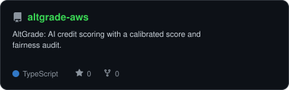</picture></a>
<a href="https://github.com/harir03/aria"><picture><source media="(prefers-color-scheme: light)" srcset="assets/card-aria-light.svg">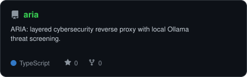</picture></a>
<a href="https://github.com/harir03/micro.ai"><picture><source media="(prefers-color-scheme: light)" srcset="assets/card-micro.ai-light.svg">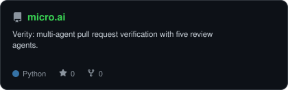</picture></a>

| project | what it is | stack |
|---|---|---|
| **[AltGrade](https://github.com/harir03/altgrade-aws)** ([live](https://altgrade.vercel.app)) | AI credit scoring with a calibrated score and a fairness audit. 0.94 AUC on synthetic data. | `FastAPI` `React` `XGBoost` `LightGBM` |
| **[ARIA](https://github.com/harir03/aria)** | Cybersecurity reverse proxy that screens traffic in layers, with a local Ollama LLM as the last one. | `Next.js` `Python` `Ollama` `Redis` |
| **[Verity](https://github.com/harir03/micro.ai)** | Multi-agent pull request verification. Five agents review each PR. | `LangGraph` `Python` `GitHub Actions` |

</div>

---

<div align="center">

## `~/` achievements

| | |
|---|---|
| 🥈 | **2nd place**, Thrust Expo, IIT Hyderabad (Team Aria) |
| 🥉 | **2nd runner-up**, Appathon, IIT Delhi |
| 🧠 | **160th of 12,885**, HackerRank Orchestrate |
| 📱 | **Top 100 of 1+ lakh**, SamsungSolve |
| 🌱 | **7 merged PRs**, Hacktoberfest 2025 |
| 🎤 | **Secretary, E-Cell**: 50-member team, events with 3000+ footfall |

</div>

---

<div align="center">

## `~/` the numbers

<picture>
  <source media="(prefers-color-scheme: light)" srcset="assets/card-stats-light.svg">
  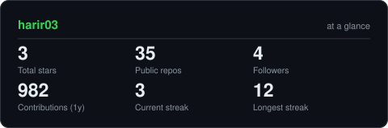
</picture>
<br><br>
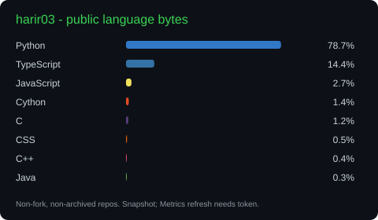
<br><br>
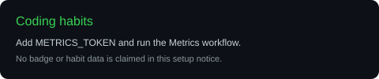
<br><br>
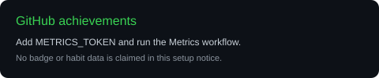

<sub>These files refresh through GitHub Actions. Habits and GitHub achievement badges need METRICS_TOKEN; until then they show a setup notice.</sub>

</div>

---

<div align="center">

## `~/` contribution calendar


</div>

---

<div align="center">

## `~/` space invaders


<sub>An animated SVG powered by the public contribution calendar, not a playable game.</sub>

</div>

---

<div align="center">

<sub>`01110100 01101000 01100001 01101110 01101011 01110011 00100000 01100110 01101111 01110010 00100000 01110011 01100011 01110010 01101111 01101100 01101100 01101001 01101110 01100111`</sub>

</div>
